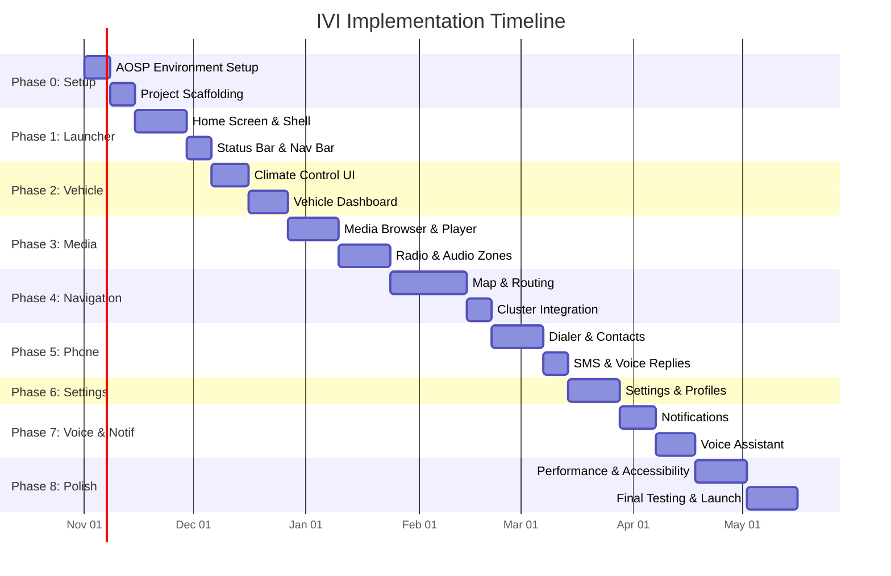

# 🚗 Car Infotainment System (IVI) — Master Implementation Plan

> **Platform:** Android Automotive OS (AAOS) / AOSP  
> **Language:** Kotlin  
> **Target API:** Android 14 (API 34) — Automotive  
> **Architecture:** MVVM + Clean Architecture  
> **Created:** 2026-10-26  

---

## 📋 Table of Contents

1. [Project Overview](#1-project-overview)
2. [System Architecture](#2-system-architecture)
3. [Module Breakdown](#3-module-breakdown)
4. [Technology Stack](#4-technology-stack)
5. [Implementation Phases](#5-implementation-phases)
6. [Detailed Sub-Plans](#6-detailed-sub-plans)
7. [Build & Deployment Strategy](#7-build--deployment-strategy)
8. [Testing Strategy](#8-testing-strategy)
9. [Timeline & Milestones](#9-timeline--milestones)

---

## 1. Project Overview

### 1.1 Vision
Build a production-grade **In-Vehicle Infotainment (IVI)** system UI on top of AOSP/Android Automotive OS. The system will provide a driver-safe, distraction-optimized interface for media, navigation, vehicle controls, climate, phone/communication, and app management — all compliant with automotive UX guidelines.

### 1.2 Key Goals
- **Driver Safety First** — Large touch targets, minimal distraction, glanceable UI
- **AOSP Integration** — Deep integration with Car API (`android.car.*`), Vehicle HAL, and system services
- **Modular Architecture** — Each feature as an independent module/app for OEM customizability
- **Performance** — 60fps rendering, cold start < 1s, optimized for automotive-grade hardware
- **Multi-Display Support** — Cluster display, center console, rear-seat entertainment
- **Theming** — Day/Night mode, OEM-brandable design tokens

### 1.3 Target Displays
| Display | Resolution | Purpose |
|---------|-----------|---------|
| Center Console (Primary) | 1920×1080 or 2560×1600 | Main IVI touchscreen |
| Instrument Cluster | 1920×720 | Speed, navigation turn-by-turn, alerts |
| Rear Seat (Optional) | 1920×1080 | Media playback, rear controls |

---

## 2. System Architecture

### 2.1 High-Level Architecture Diagram

```
┌─────────────────────────────────────────────────────────────────┐
│                        IVI Application Layer                     │
│  ┌──────────┐ ┌──────────┐ ┌──────────┐ ┌──────────┐           │
│  │  Launcher│ │  Media   │ │Navigation│ │ Climate  │  ...       │
│  │   App    │ │  Center  │ │   App    │ │ Control  │           │
│  └────┬─────┘ └────┬─────┘ └────┬─────┘ └────┬─────┘           │
│       │             │            │             │                 │
│  ┌────┴─────────────┴────────────┴─────────────┴──────────────┐ │
│  │              Shared UI Library (Design System)              │ │
│  │         Car UI Lib · Themes · Components · Animations       │ │
│  └────┬────────────────────────────────────────────────────────┘ │
│       │                                                          │
│  ┌────┴────────────────────────────────────────────────────────┐ │
│  │                    Core Services Layer                       │ │
│  │  VehicleDataService · MediaService · NavigationService      │ │
│  │  ClimateService · PhoneService · NotificationService        │ │
│  └────┬────────────────────────────────────────────────────────┘ │
├───────┼──────────────────────────────────────────────────────────┤
│       │         Android Automotive OS / AOSP Framework           │
│  ┌────┴────────────────────────────────────────────────────────┐ │
│  │  CarService · Car API (android.car.*)                       │ │
│  │  MediaBrowserService · CarAudioManager                      │ │
│  │  CarPropertyManager · CarClimateManager                     │ │
│  │  CarNavigationStatusManager · TelephonyManager              │ │
│  └────┬────────────────────────────────────────────────────────┘ │
├───────┼──────────────────────────────────────────────────────────┤
│       │              Hardware Abstraction Layer (HAL)             │
│  ┌────┴────────────────────────────────────────────────────────┐ │
│  │  Vehicle HAL · Audio HAL · Display HAL · Bluetooth HAL      │ │
│  │  GNSS HAL · Sensors HAL · CAN Bus Interface                 │ │
│  └─────────────────────────────────────────────────────────────┘ │
└─────────────────────────────────────────────────────────────────┘
```

### 2.2 App Architecture Pattern (Per Module)

```
┌─────────────────────────────────────────┐
│              Presentation Layer          │
│  Activities / Fragments / Compose UI     │
│  ViewModels (StateFlow / LiveData)       │
├─────────────────────────────────────────┤
│              Domain Layer                │
│  UseCases / Interactors                  │
│  Domain Models                           │
│  Repository Interfaces                   │
├─────────────────────────────────────────┤
│              Data Layer                  │
│  Repository Implementations              │
│  Car API Data Sources                    │
│  Local Data Sources (Room / DataStore)   │
│  Remote Data Sources (if connected)      │
└─────────────────────────────────────────┘
```

---

## 3. Module Breakdown

### 3.1 Application Modules

| # | Module | Package | Description |
|---|--------|---------|-------------|
| 1 | **Launcher/Home** | `com.ivi.launcher` | Home screen, app drawer, widget grid, status bar |
| 2 | **Media Center** | `com.ivi.media` | Music, radio, podcasts, Bluetooth audio, USB media |
| 3 | **Navigation** | `com.ivi.navigation` | Maps, turn-by-turn, POI, traffic, route planning |
| 4 | **Climate Control** | `com.ivi.climate` | HVAC, seat heating/cooling, fan speed, zone control |
| 5 | **Vehicle Status** | `com.ivi.vehicle` | Dashboard, TPMS, fuel/battery, ADAS status, diagnostics |
| 6 | **Phone/Comms** | `com.ivi.phone` | Dialer, contacts, call log, SMS, Bluetooth HFP |
| 7 | **Settings** | `com.ivi.settings` | System settings, display, audio, connectivity, profiles |
| 8 | **Notifications** | `com.ivi.notifications` | Heads-up alerts, notification center, driver alerts |
| 9 | **App Store** | `com.ivi.appstore` | OEM app marketplace (optional) |
| 10 | **Voice Assistant** | `com.ivi.voice` | Voice command integration, NLU pipeline |

### 3.2 Library Modules

| # | Module | Package | Description |
|---|--------|---------|-------------|
| L1 | **Design System** | `com.ivi.designsystem` | Tokens, themes, components, icons, typography |
| L2 | **Car Service Client** | `com.ivi.carservice` | Wrappers around `android.car.*` APIs |
| L3 | **Common/Core** | `com.ivi.core` | Extensions, utils, base classes, DI setup |
| L4 | **Testing** | `com.ivi.testing` | Shared test utilities, fakes, test fixtures |

---

## 4. Technology Stack

### 4.1 Core Technologies

| Category | Technology | Justification |
|----------|-----------|---------------|
| **Language** | Kotlin 1.9+ | Primary language, full AOSP Kotlin support |
| **UI Framework** | Jetpack Compose + Car App Library | Modern declarative UI, automotive-optimized |
| **UI Fallback** | XML Layouts + Car UI Library | For components requiring traditional Views |
| **Architecture** | MVVM + Clean Architecture | Separation of concerns, testability |
| **DI** | Hilt (Dagger) | Compile-time dependency injection |
| **Async** | Kotlin Coroutines + Flow | Reactive data streams from Car APIs |
| **Navigation** | Jetpack Navigation (Compose) | Type-safe navigation between screens |
| **Local Storage** | Room + DataStore (Preferences) | User preferences, cached data |
| **Image Loading** | Coil | Lightweight, Kotlin-first image loading |
| **Serialization** | Kotlinx Serialization | JSON parsing, data classes |
| **Build System** | Gradle (Kotlin DSL) + Soong (AOSP) | Dual build: standalone + AOSP integration |

### 4.2 AOSP / Automotive-Specific APIs

| API | Package | Usage |
|-----|---------|-------|
| Car API | `android.car.*` | Core vehicle interaction |
| CarPropertyManager | `android.car.hardware.property` | Vehicle properties (speed, fuel, gear) |
| CarAudioManager | `android.car.media` | Audio zones, volume control |
| CarClimateManager | `android.car.hardware.hvac` | Climate/HVAC control |
| CarNavigationStatusManager | `android.car.navigation` | Nav status to cluster |
| CarUxRestrictionsManager | `android.car.drivingstate` | UX restrictions (driving state) |
| MediaBrowserServiceCompat | `androidx.media` | Media source browsing |
| CarAppService | `androidx.car.app` | Templated car apps |

### 4.3 Testing Stack

| Type | Tool |
|------|------|
| Unit Tests | JUnit 5 + MockK + Turbine (Flow testing) |
| UI Tests | Compose UI Test + Espresso |
| Integration | Robolectric with AAOS shadows |
| E2E | UI Automator + AAOS Emulator |
| Performance | Benchmark (Macrobenchmark) |

---

## 5. Implementation Phases

### Phase 0: Foundation & Setup (Weeks 1–2)
- AOSP source tree setup & build environment
- Project scaffolding (multi-module Gradle)
- Design system foundation (tokens, theme, base components)
- Car Service client library skeleton
- CI/CD pipeline setup

### Phase 1: Launcher & System Shell (Weeks 3–5)
- Home screen with app grid/carousel
- System status bar (time, connectivity, battery)
- Navigation bar (bottom/side)
- App drawer
- Multi-display awareness

### Phase 2: Climate & Vehicle Controls (Weeks 6–8)
- Climate control UI (temperature, fan, zones, seat heat)
- Vehicle status dashboard (speed, fuel/battery, TPMS, gear)
- Car Property Manager integration
- Real-time data streaming via Flow

### Phase 3: Media Center (Weeks 9–12)
- Media browser (browse media sources)
- Now Playing screen (album art, controls, progress)
- Radio tuner (AM/FM/DAB)
- USB/Bluetooth media playback
- Audio zone management
- Media notification integration

### Phase 4: Navigation (Weeks 13–16)
- Map rendering (MapLibre / Google Maps Automotive)
- Search & POI
- Route planning & turn-by-turn
- Cluster display integration (nav cards)
- Traffic overlay
- Offline maps support

### Phase 5: Phone & Communications (Weeks 17–19)
- Bluetooth HFP integration
- Dialer with large touch targets
- Contact list (synced via PBAP)
- Call log & favorites
- SMS viewer (read-only while driving)
- Voice-to-text replies

### Phase 6: Settings & Profiles (Weeks 20–21)
- System settings (display, sound, connectivity)
- User profile management
- Wi-Fi, Bluetooth pairing
- Software update UI
- About / diagnostics

### Phase 7: Notifications & Voice (Weeks 22–24)
- Notification center (grouped, prioritized)
- Heads-up notifications (driver-safe)
- UX Restrictions enforcement
- Voice assistant integration
- Wake word detection pipeline

### Phase 8: Polish, Testing & Launch (Weeks 25–28)
- Performance optimization (startup, rendering)
- Accessibility (TalkBack, switch access)
- Full test suite execution
- Multi-language support (i18n)
- OEM theming/branding hooks
- Documentation & handoff

---

## 6. Detailed Sub-Plans

Each phase has a dedicated detailed plan document:

| Document | Description |
|----------|-------------|
| [01_Project_Setup_and_Architecture.md](file:///c:/Users/abhis/AOSP/Projects/IVI%20Project/AI%20Plans/01_Project_Setup_and_Architecture.md) | AOSP setup, project scaffolding, architecture details |
| [02_Design_System.md](file:///c:/Users/abhis/AOSP/Projects/IVI%20Project/AI%20Plans/02_Design_System.md) | Complete design system: tokens, components, theming |
| [03_Launcher_and_System_Shell.md](file:///c:/Users/abhis/AOSP/Projects/IVI%20Project/AI%20Plans/03_Launcher_and_System_Shell.md) | Home screen, status bar, navigation, app drawer |
| [04_Climate_and_Vehicle.md](file:///c:/Users/abhis/AOSP/Projects/IVI%20Project/AI%20Plans/04_Climate_and_Vehicle.md) | HVAC controls, vehicle dashboard, Car API integration |
| [05_Media_Center.md](file:///c:/Users/abhis/AOSP/Projects/IVI%20Project/AI%20Plans/05_Media_Center.md) | Media browsing, playback, radio, audio zones |
| [06_Navigation.md](file:///c:/Users/abhis/AOSP/Projects/IVI%20Project/AI%20Plans/06_Navigation.md) | Maps, routing, cluster integration |
| [07_Phone_and_Communications.md](file:///c:/Users/abhis/AOSP/Projects/IVI%20Project/AI%20Plans/07_Phone_and_Communications.md) | Dialer, contacts, Bluetooth HFP, SMS |
| [08_Settings_and_Profiles.md](file:///c:/Users/abhis/AOSP/Projects/IVI%20Project/AI%20Plans/08_Settings_and_Profiles.md) | System settings, user profiles, connectivity |
| [09_Notifications_and_Voice.md](file:///c:/Users/abhis/AOSP/Projects/IVI%20Project/AI%20Plans/09_Notifications_and_Voice.md) | Notification system, voice assistant |
| [10_Testing_and_Quality.md](file:///c:/Users/abhis/AOSP/Projects/IVI%20Project/AI%20Plans/10_Testing_and_Quality.md) | Test strategy, CI/CD, performance benchmarks |

---

## 7. Build & Deployment Strategy

### 7.1 Dual Build System

```
IVI-Project/
├── build.gradle.kts          ← Gradle root (for IDE development)
├── Android.bp                ← Soong build file (for AOSP integration)
├── settings.gradle.kts       ← Module declarations
├── app/                      ← Launcher/Shell app
├── features/
│   ├── media/
│   ├── navigation/
│   ├── climate/
│   ├── vehicle/
│   ├── phone/
│   └── settings/
├── libraries/
│   ├── designsystem/
│   ├── carservice/
│   ├── core/
│   └── testing/
└── aosp/
    ├── sepolicy/             ← SELinux policies
    ├── overlays/             ← Runtime Resource Overlays (RRO)
    ├── permissions/          ← Custom permissions XML
    └── init/                 ← Init scripts
```

### 7.2 Build Variants

| Variant | Purpose |
|---------|---------|
| `debug` | Development with mock Car APIs, emulator support |
| `staging` | Real Car API integration, test hardware |
| `release` | Production, signed with platform key, optimized |

### 7.3 AOSP Integration Steps
1. Add project to `packages/apps/IVI/` in AOSP tree
2. Create `Android.bp` for Soong build system
3. Sign with platform certificate for system-level permissions
4. Add to device makefile (`PRODUCT_PACKAGES += IVILauncher IVIMedia ...`)
5. Configure SELinux policies for Car API access
6. Set up Runtime Resource Overlays for OEM theming

---

## 8. Testing Strategy

### 8.1 Testing Pyramid

```
          ┌───────────┐
          │   E2E     │  ← 10% — Full system on AAOS emulator/hardware
          │  Tests    │
         ┌┴───────────┴┐
         │ Integration  │  ← 20% — Multi-module, Car API mocks
         │   Tests      │
        ┌┴──────────────┴┐
        │   UI Tests      │  ← 30% — Compose UI, screenshot tests
        │                 │
       ┌┴─────────────────┴┐
       │    Unit Tests      │  ← 40% — ViewModels, UseCases, Repos
       │                    │
       └────────────────────┘
```

### 8.2 Automotive-Specific Testing
- **UX Restriction Compliance** — Verify UI adapts when driving state changes
- **Multi-Display Testing** — Validate on cluster + center console simultaneously
- **Audio Focus** — Ensure proper audio focus handling across media sources
- **Vehicle Property Simulation** — Test with simulated CAN bus data
- **Distraction Testing** — Verify touch target sizes ≥ 76dp × 76dp

---

## 9. Timeline & Milestones



### Key Milestones

| Milestone | Target Date | Deliverable |
|-----------|------------|-------------|
| M0: Environment Ready | Week 2 | Buildable AOSP image with skeleton apps |
| M1: Launcher MVP | Week 5 | Functional home screen on emulator |
| M2: Vehicle Controls | Week 8 | Climate + vehicle dashboard working |
| M3: Media Playback | Week 12 | Full media center with audio |
| M4: Navigation | Week 16 | Map with turn-by-turn navigation |
| M5: Communications | Week 19 | Phone dialer + contacts |
| M6: Feature Complete | Week 24 | All features implemented |
| M7: Release Candidate | Week 28 | Fully tested, polished build |

---

> [!IMPORTANT]
> This master plan links to 10 detailed sub-plan documents (listed in Section 6). Each sub-plan contains file-by-file implementation details, code samples, API integration guides, and UI specifications.

---

*Next Steps: Review this master plan, then proceed to the detailed sub-plans starting with [01_Project_Setup_and_Architecture.md](file:///c:/Users/abhis/AOSP/Projects/IVI%20Project/AI%20Plans/01_Project_Setup_and_Architecture.md).*
